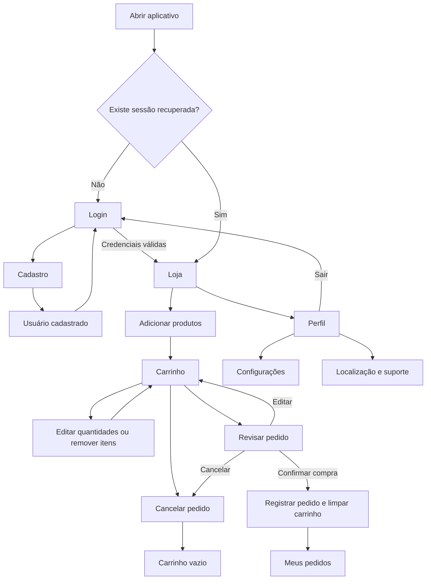

# Compre Agora — guia para explicar o projeto

Este guia descreve a implementação atual e pode ser usado como roteiro de apresentação e demonstração.

## 1. Como apresentar o aplicativo

> “O Compre Agora é um aplicativo mobile que demonstra um fluxo de compras: criar uma conta, entrar, consultar produtos, montar um carrinho, revisar a compra e consultar os pedidos. Ele também utiliza recursos do celular, como localização, informações do dispositivo, vibração e notificações locais em builds próprios.”

O objetivo é organizar a experiência de compra em telas simples, com identidade visual própria e navegação por abas. É um protótipo acadêmico: a confirmação registra um pedido no dispositivo, sem cobrança ou processamento de pagamento.

## 2. Tecnologias utilizadas

| Tecnologia | Onde entra no projeto | Como explicar na apresentação |
| --- | --- | --- |
| JavaScript e JSX | Arquivos `.js` das telas, componentes e serviços | “A lógica é escrita em JavaScript e a interface é descrita com JSX.” |
| React 19.2.3 | Componentes e hooks | “O React organiza a interface em componentes e atualiza a tela quando os dados mudam.” |
| React Native 0.86.3 | Interface mobile | “Utilizo componentes como Text, View, Image, TextInput e FlatList para construir a interface do aplicativo.” |
| Expo SDK 57 | Ambiente e módulos do aplicativo | “O Expo reúne as ferramentas e os módulos que o projeto utiliza para desenvolvimento mobile.” |
| Expo Router | Rotas em `src/app/` | “Cada arquivo de rota representa uma tela. Uso uma navegação em pilha e abas para organizar o acesso.” |
| Context API | `src/context/AppContext.js` | “As telas compartilham os dados do usuário, carrinho, produtos e pedidos por um contexto.” |
| AsyncStorage | Sessão e carrinho | “Mantém a sessão e o carrinho no dispositivo para recuperá-los ao abrir o app novamente.” |
| expo-sqlite | `src/services/database.js` | “O SQLite guarda os cadastros e o histórico de pedidos em um banco no celular.” |
| Axios | `src/services/api.js` | “Faz a requisição HTTP que busca os produtos na Fake Store API.” |
| expo-location | Perfil e carrinho | “Solicita permissão, obtém as coordenadas e tenta encontrar um endereço correspondente.” |
| expo-device | Configurações | “Consulta sistema operacional, versão, marca, modelo e tipo do dispositivo.” |
| expo-notifications | Confirmação da compra em build próprio | “Tenta apresentar uma notificação local após confirmar o pedido.” |
| Vibration, do React Native | Adicionar produto e confirmar compra | “Oferece um retorno tátil para as ações do usuário.” |
| expo-linking | Suporte no perfil | “Abre um link externo de atendimento.” |
| Ionicons, de @expo/vector-icons | Abas e botões | “Os ícones ajudam a identificar loja, carrinho, pedidos, perfil e ações.” |
| react-native-safe-area-context | Telas | “Mantém o conteúdo dentro da área segura do celular.” |
| ESLint e TypeScript | Verificação do código | “Executo lint e checagem de tipos. As telas continuam escritas em JavaScript, com checkJs habilitado.” |
| EAS Build | Geração do instalador | “Envia o projeto ao serviço de build do Expo, que compila e assina o APK na nuvem.” |

React Native Reanimated e Worklets também estão instalados como suporte às dependências de navegação. O aplicativo não implementa animações personalizadas com essas bibliotecas.

## 3. Organização dos arquivos

```text
index.js                     Entrada do Expo Router
app.json                     Nome, logo, permissões e configuração do app
eas.json                     Perfis de build
assets/                      Logo e demais imagens
src/
  app/                       Rotas e layouts de navegação
    _layout.js               Provider e navegação principal
    login.js                 Rota de login
    register.js              Rota de cadastro
    settings.js              Rota de configurações
    (shop)/                  Grupo das telas com abas
      _layout.js             Abas e verificação da sessão
      index.js               Loja
      cart.js                Carrinho
      orders.js              Pedidos
      profile.js             Perfil
  screens/                   Conteúdo das telas
  components/                Formulário, logo, produtos e localização
  context/AppContext.js      Estado compartilhado e ações do aplicativo
  services/api.js            Comunicação com a API de produtos
  services/database.js       Consultas e gravações em SQLite
  theme.js                   Cores e estilos compartilhados
```

> “Separei a navegação, as telas, os componentes reutilizáveis e os serviços. Assim, a tela apresenta os dados, o contexto controla as ações e os serviços cuidam da API e do banco.”

## 4. Visão geral dos fluxos



O diagrama resume o caminho de uso. “Meus pedidos” é acessado pela aba; a confirmação da compra não redireciona automaticamente para essa tela.

## 5. Abertura e recuperação da sessão

1. O aplicativo inicializa as tabelas do banco, caso ainda não existam.
2. Recupera a sessão e o carrinho do AsyncStorage.
3. Se houver sessão, carrega os pedidos associados ao e-mail do usuário.
4. As abas protegidas aguardam a recuperação dos dados.
5. Sem sessão, o usuário é direcionado ao login. Com sessão, acessa a loja.

> “O app consegue lembrar quem estava conectado e recuperar o carrinho depois de ser fechado.”

## 6. Cadastro

1. No login, o usuário toca em **Não tenho conta · Criar cadastro**.
2. Preenche nome, e-mail, senha e confirmação da senha.
3. O formulário verifica campos obrigatórios e o formato do e-mail.
4. A senha deve ter pelo menos seis caracteres e coincidir com a confirmação.
5. O contexto normaliza o e-mail, removendo espaços das extremidades e convertendo para minúsculas.
6. Se o e-mail já estiver cadastrado, informa a duplicidade.
7. Se estiver disponível, cria o usuário no SQLite.
8. Exibe somente **Usuário cadastrado** e retorna ao login.

> “Cadastro e login são ações separadas. Cadastrar não entra automaticamente na conta.”

## 7. Login e saída

No login, o usuário informa e-mail e senha. O aplicativo consulta o cadastro no SQLite, compara a senha e libera o acesso quando os dados estão corretos. Conta inexistente e senha incorreta recebem mensagens específicas.

A sessão salva contém identificador, nome e e-mail. A senha não é incluída nesse objeto de sessão.

Ao tocar em **Sair da conta**, o app encerra a sessão e limpa o carrinho, os pedidos exibidos e a localização em memória. Os cadastros e pedidos continuam no SQLite para consulta em um próximo login.

> “A autenticação deste protótipo acontece no próprio dispositivo. Uma conta criada em um celular não é sincronizada automaticamente com outro.”

## 8. Loja e comunicação com a API

1. Ao abrir a loja, o aplicativo solicita os produtos à Fake Store API pelo endpoint `/products`.
2. O Axios utiliza a base `https://fakestoreapi.com` e um tempo limite de dez segundos.
3. A tela mostra imagem, nome, categoria, preço e botão para adicionar ao carrinho.
4. Durante o carregamento, apresenta um indicador visual.
5. O usuário pode puxar a lista para atualizar.
6. Se a requisição falhar, recebe um aviso de indisponibilidade.

> “O catálogo vem de uma API externa. Eu não cadastro esses produtos manualmente no banco do aplicativo.”

Os valores recebidos da API são apresentados com formatação em reais, sem conversão cambial implementada. Não há cache persistente do catálogo; buscar ou atualizar os produtos depende de internet.

## 9. Carrinho, edição e cancelamento

Ao adicionar um produto, o aplicativo cria um item com quantidade um. Se o mesmo produto já estiver no carrinho, aumenta sua quantidade. A ação também aciona uma vibração.

No carrinho, o usuário pode:

- Aumentar ou diminuir a quantidade.
- Remover um produto; diminuir a quantidade a zero também remove o item.
- Consultar o total, calculado pela soma de preço multiplicado pela quantidade.
- Usar sua localização, se desejar.
- Cancelar o pedido, após confirmar a remoção dos produtos do carrinho.
- Abrir a revisão antes de concluir a compra.

As alterações no carrinho são persistidas automaticamente, sem apresentar mensagens sobre o armazenamento ao usuário. O contador na aba soma as quantidades dos produtos.

> “Antes de confirmar, o usuário tem controle sobre a compra: pode alterar os itens ou cancelar todo o carrinho.”

## 10. Revisão e confirmação da compra

1. O usuário toca em **Revisar pedido**.
2. Um modal apresenta produtos, quantidades, subtotais, total e localização, quando obtida.
3. **Editar pedido** fecha a revisão para permitir ajustes no carrinho.
4. **Cancelar pedido** pede confirmação e esvazia o carrinho.
5. **Confirmar compra** verifica se há usuário conectado e itens no carrinho.
6. O aplicativo registra o pedido no SQLite, atualiza o histórico e esvazia o carrinho.
7. Aciona vibração e tenta emitir uma notificação local no ambiente compatível.
8. Exibe a confirmação de pedido finalizado.

Durante a confirmação, os botões são desabilitados e uma trava evita uma segunda execução enquanto a primeira está em andamento. Uma falha na notificação é tratada separadamente para não impedir a conclusão do pedido.

> “Finalizar a compra, neste projeto, significa registrar o pedido. Não existe integração com cartão, Pix, estoque ou entrega.”

## 11. Histórico de pedidos

A aba **Pedidos** consulta os pedidos do e-mail conectado e mostra os mais recentes primeiro. Cada cartão apresenta número do pedido, confirmação, quantidade de itens, data, total e coordenadas, quando disponíveis.

O banco registra o resumo da compra. Não mantém uma tabela com cada produto comprado. A tela atual também não permite editar ou cancelar um pedido já confirmado; essas ações ficam disponíveis antes da confirmação, no carrinho e na revisão.

> “O histórico permite consultar as compras registradas naquele dispositivo e vinculadas ao usuário conectado.”

## 12. Localização

1. No perfil ou carrinho, o usuário toca em **Usar minha localização**.
2. O app solicita a permissão de localização durante o uso.
3. Verifica se os serviços de localização do celular estão ativados.
4. Obtém latitude e longitude e mostra as coordenadas.
5. Tenta converter as coordenadas em endereço, processo chamado geocodificação reversa.
6. Se o serviço de endereço falhar, mantém as coordenadas visíveis.
7. Permissão negada, GPS desligado e falha de obtenção recebem mensagens próprias.

A localização é opcional para concluir a compra. O app não exibe um mapa nem acompanha o usuário continuamente. O endereço fica no estado da sessão; o resumo do pedido armazena latitude e longitude.

> “Utilizo a localização para mostrar onde o usuário está e associar coordenadas ao pedido, quando ele autoriza.”

## 13. Perfil, configurações e suporte

O perfil reúne nome, e-mail, localização, acesso às configurações, suporte e saída da conta.

Em **Configurações**, o aplicativo apresenta sistema operacional, versão, marca, modelo e tipo do dispositivo. Esses dados vêm do `expo-device` e ficam fora das telas de compra.

O botão de suporte utiliza `expo-linking` para abrir um link do WhatsApp. O número configurado no código é demonstrativo e deve ser substituído pelo contato real para uso comercial.

> “O perfil concentra as opções da conta, e as informações técnicas ficam em uma tela de configurações.”

## 14. Como os dados são organizados

| Local | Dados mantidos | Finalidade |
| --- | --- | --- |
| Context API, em memória | Usuário, produtos, carrinho, pedidos, localização e estados de carregamento | Compartilhar e atualizar os dados durante o uso |
| AsyncStorage | Sessão e carrinho, serializados em JSON | Recuperar o acesso e os itens ao reabrir o aplicativo |
| SQLite, tabela `users` | ID, nome, e-mail único, senha e data de cadastro | Consultar e criar cadastros locais |
| SQLite, tabela `orders` | ID, data, cliente, e-mail, total, quantidade e coordenadas opcionais | Manter o resumo dos pedidos |
| API externa | Catálogo buscado pela rede | Fornecer os produtos exibidos na loja |

> “O Context organiza os dados durante a execução, o AsyncStorage recupera sessão e carrinho, e o SQLite guarda os cadastros e pedidos.”

## 15. Hooks: exemplos que posso explicar

- **useState:** guarda dados que mudam, como os campos do formulário, o carrinho e os indicadores de carregamento.
- **useEffect:** inicializa dados, busca produtos na abertura da loja e persiste alterações do carrinho.
- **useContext:** permite que cada tela acesse as informações e ações compartilhadas.
- **useMemo:** reutiliza o cálculo do total enquanto o carrinho não muda e organiza as informações do dispositivo.
- **useCallback:** mantém referências de funções usadas nos efeitos, como a busca de produtos.
- **useRef:** mantém a trava da confirmação sem depender de uma nova renderização.

> “Uso os hooks para controlar o estado, executar operações externas e organizar as atualizações da interface.”

## 16. Expo Go, APK e geração do instalador

Durante o desenvolvimento, o projeto pode ser aberto com o servidor do Expo. No Expo Go Android, este código evita importar `expo-notifications`, porque o pacote utilizado registra um listener de push na importação e gera erro nesse ambiente. A confirmação continua sendo mostrada por alerta.

No build próprio, o app tenta apresentar uma notificação local de confirmação, conforme a permissão do sistema. O projeto não envia notificações remotas por servidor.

O perfil `preview` do `eas.json` está configurado com distribuição interna e `buildType: apk`. O comando de geração é:

```bash
npx eas-cli@latest build --platform android --profile preview
```

> “O EAS Build compila e assina o instalador na nuvem. O APK permite instalar o Compre Agora no Android com seu nome e sua logo.”

## 17. Roteiro de demonstração

1. Apresentar o nome, a logo e o objetivo do aplicativo.
2. Se uma sessão estiver ativa, sair pelo perfil para demonstrar o login.
3. Abrir o cadastro e criar uma conta com e-mail ainda não utilizado.
4. Mostrar a mensagem **Usuário cadastrado** e entrar com e-mail e senha.
5. Mostrar a loja, os produtos carregados e a atualização da lista.
6. Adicionar dois produtos e mostrar o contador no carrinho.
7. Alterar a quantidade e remover um item, observando o total.
8. Obter a localização com a permissão e o GPS ativados.
9. Abrir a revisão e usar **Editar pedido** para retornar ao carrinho.
10. Demonstrar o cancelamento; depois adicionar produtos novamente.
11. Revisar e confirmar uma compra.
12. Abrir **Pedidos** para mostrar o registro criado.
13. Abrir **Perfil → Configurações** para mostrar os dados do dispositivo.
14. Encerrar a sessão e explicar quais dados permanecem no celular.

Para demonstrar o catálogo, use conexão com internet. Para demonstrar a notificação local, utilize um build próprio com permissão de notificações. Um pedido finalizado na demonstração permanece no histórico local.

## 18. Perguntas que podem surgir

**O aplicativo funciona sem internet?**

O cadastro e o login consultam o banco local, e o histórico permanece no dispositivo. Buscar produtos depende da API e as imagens utilizam URLs externas. O catálogo não possui cache persistente. A obtenção do endereço também pode depender de serviços externos.

**Qual é a diferença entre AsyncStorage e SQLite?**

O AsyncStorage guarda pares de chave e valor, como sessão e carrinho em JSON. O SQLite organiza usuários e pedidos em tabelas e permite consultas SQL.

**Os dados são compartilhados entre celulares?**

Não há sincronização com um servidor. Cada instalação mantém seus próprios dados.

**A senha é criptografada?**

Na implementação atual, a senha é armazenada como texto no SQLite e comparada localmente. Uma evolução para uso comercial deve adotar autenticação segura em servidor e tratamento adequado das credenciais.

**A confirmação cobra o cliente?**

Não. Ela registra um pedido demonstrativo, sem gateway de pagamento.

**Existe rastreamento de entrega ou controle de estoque?**

Não estão implementados. As coordenadas registradas não representam acompanhamento de entrega.

**Quais verificações foram realizadas?**

Foram executados lint, checagem de tipos e exportação dos bundles Android e iOS. Também foram verificados fluxos de autenticação, carrinho e confirmação com SQLite em memória e módulos nativos simulados. Aparência, GPS, permissões e notificações precisam de validação no dispositivo; exportar um bundle não equivale a validar todo o APK.

## 19. Fala pronta para encerrar a apresentação

> “O Compre Agora reúne os principais passos de uma compra em um protótipo mobile: cadastro, login, catálogo, carrinho editável, revisão e histórico. Utilizei React Native com Expo, Expo Router para navegação, Context API para compartilhar estado, AsyncStorage e SQLite para persistência, Axios para buscar produtos e módulos do Expo para acessar recursos do celular. O projeto demonstra a integração dessas tecnologias. Os próximos passos seriam autenticação em servidor, sincronização de dados, pagamentos e gestão de pedidos e estoque.”
